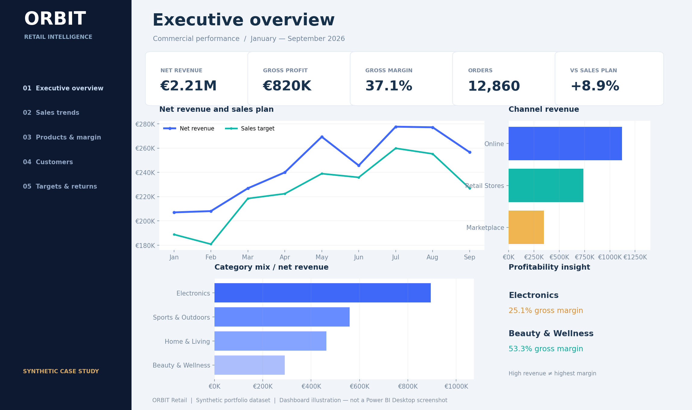

# ORBIT Retail | Power BI Sales Intelligence

**Junior Data Analyst portfolio project** · Power BI · DAX · Power Query · Data Modeling · KPI Reporting  
**Period:** January 2024 – September 2026 · **Currency:** EUR (€) · **Data:** **SYNTHETIC, REPRODUCIBLE**

> **Research / portfolio transparency:** ORBIT Retail is a fictional ecommerce + physical-store retailer. No business, customer or financial record in this case study is real. The project is designed to demonstrate transferable commercial data-analysis techniques distinct from fraud analytics.



## 1. Business objective

Management needs one consistent source for five questions:

1. How much revenue and gross profit did the business generate, and how has performance changed over time?
2. Which products, categories, channels and regions drive sales and margin — and which cause value leakage?
3. What is the average value of an order and how does performance differ by customer segment?
4. Are commercial teams hitting their monthly region/channel sales targets?
5. Where do discounts and returns erode gross-to-net revenue?

The **analysis** separates descriptive outcomes, financial contribution, target tracking and operational follow-up. It does not conflate revenue with profit or assume that observed patterns prove causality.

## 2. Deliverables

| File or folder | Purpose |
|---|---|
| `Orbit_Retail_Sales_Analysis.pbip` | Power BI Desktop Project entry point |
| `Orbit_Retail_Sales_Analysis.SemanticModel/` | Editable TMDL semantic model, embedded Power Query import, tables, relationships, DAX |
| `Orbit_Retail_Sales_Analysis.Report/` | Editable PBIR report structure: 5 pages, 60 visuals |
| `Dashboard_Preview.html` | Offline interactive companion dashboard (open in a browser) |
| `Dashboard_Preview.png` | Executive dashboard illustration for GitHub / CV portfolio |
| `Data/*.csv` | The seven original data tables for transparency and further work |
| `DAX_Measures.dax` | Readable DAX catalog (29 measures) |
| `MODEL_DICTIONARY.json` | Star schema and KPI metric definitions |
| `analysis_results.json` | Auditable output / expected results and aggregated preview data |
| `data_quality_report.json` | Automated quality checks |
| `Power_Query_Notes.md` | Data loading / embedded import design |

### Opening the project

1. **Extract the ZIP** to a normal Windows folder. Keep all generated folders together.
2. Open `Orbit_Retail_Sales_Analysis.pbip` in an up-to-date **Power BI Desktop**.
3. If Desktop prompts you, select **Apply changes** or **Refresh** to load the sample data.
4. Explore five report pages. Use the **Year** slicer or the standard Filters pane to change context.
5. To create a conventional `.pbix`, choose **File → Save As → Power BI Desktop file (.pbix)** (in compatible versions of Power BI Desktop).

The import uses base64-compressed CSV tables inside Power Query M. This avoids machine-dependent Windows paths, inaccessible SharePoint sources, credentials or an Internet connection. The **Data** folder contains the uncompressed audit copies. The dataset is a **fixed snapshot**, not a live data connection.

**Testing status:** CSV calculations, foreign keys and embedded import round-trips passed automated checks; all PBIR JSON files parse and visual positions were checked. Power BI Desktop itself is not available in this environment, so actual opening/rendering of the PBIP **has not been tested**. If your Desktop release rejects any generated PBIR metadata, the dataset and DAX source files remain usable for repair.

## 3. Dataset & data model

- **37,969 distinct orders**, **47,832 order lines**, **3,600 customer records** and **96 product SKUs**.
- Coverage: **2024-01-01 to 2026-09-30** (no data after that date).
- 4 regions × 3 channels (Online, Retail Stores, Marketplace).
- Monthly targets: **396 rows**, allocated by month/region/channel.

**Star schema (single-direction, 1 → many):**

```text
                   DimDates
                 /          \
                v            v
DimProducts --> FactSales   FactTargets <-- DimRegions
                  ^   ^       ^     ^
                  |   |       |     |
           DimCustomers |       DimChannels
                       |____________|

FactSales grain   = 1 product line within 1 order.
FactTargets grain = 1 calendar month × region × channel.
```

`DimDates`, `DimRegions` and `DimChannels` are shared/conformed dimensions; `DimProducts` and `DimCustomers` filter the sales fact only. Targets deliberately have **no product key**, so category-specific planned revenue cannot be claimed or fabricated.

### Metric definitions (important)

| KPI | Definition | Caveat |
|---|---|---|
| Gross Sales | SUM(quantity × list price) | Before discounts / returns |
| Net Revenue | Gross sales − discounts − refund value | Includes return adjustments allocated to original order month |
| Gross Profit | Net revenue − net COGS | Excludes fulfillment, payroll, advertising, tax and operating overhead |
| Gross Margin % | Gross profit / net revenue | Not the business's net margin |
| Return Rate % | Returned units / ordered units | Recent return periods are still immature |
| Average Order Value | Net revenue / DISTINCTCOUNT(OrderID) | Requires distinct order count, not line count |
| Sales Target | SUM(monthly region/channel sales target) | Target grain = month × region × channel |
| Sales Variance % | (Net revenue − sales target) / sales target | Prefer complete months / appropriate time selection |
| Revenue PY | Same date context one year earlier | Use matched period for 2026 YTD comparison |

There are **29 DAX measures** grouped under Revenue, Profitability, Customers, Returns, Targets, Time Intelligence and Portfolio Headlines.

## 4. Pages in the Power BI report

**01 — Executive Summary:** net revenue, gross profit, gross margin, orders and actual-vs-target KPI cards; trend vs plan, sales by channel and region, category scorecard.

**02 — Sales Trends:** 2026 YTD and prior-year comparable sales, YTD growth, AOV, discount rate, current vs previous-year trend, channel and regional analysis.

**03 — Products & Margin:** category revenue and gross-profit contributions, product-level performance, margin and return exposure.

**04 — Customers & Channels:** active purchasing customers, AOV, revenue/customer, segment contribution, acquisition source and channel unit economics.

**05 — Targets & Returns:** monthly actual-vs-plan comparison, target attainment, variance by channel and refunds / category leakage.

## 5. Selected findings — reproducible synthetic scenario

As of **September 30, 2026**, compared with January–September 2025:

| 2026 Jan–Sep KPI | Value |
|---|---:|
| Net revenue | **€2,208,295** |
| Gross profit | **€820,004** |
| Gross margin | **37.1%** |
| Distinct orders | **12,860** |
| Comparable-period growth | **+27.1%** |
| Sales against plan | **+8.9%** |
| Refund value | **€96,988** |

### Product mix, Jan–Sep 2026

| Category | Net revenue | Gross margin | Refund value |
|---|---:|---:|---:|
| Electronics | €895,123 | 25.1% | €50,887 |
| Sports & Outdoors | €559,488 | 40.5% | €18,668 |
| Home & Living | €463,309 | 46.2% | €19,107 |
| Beauty & Wellness | €290,375 | 53.3% | €8,326 |

**Interpretation:** Electronics are the highest-revenue category at roughly €895K, but achieve only **25.1%** gross margin, substantially below Beauty & Wellness (**53.3%**). Electronics also account for roughly **€51K** of refund exposure.

**Action to investigate:** break down Electronics returns by SKU, promotion status and channel, and audit whether heavily discounted SKUs still cover their direct costs. This is a *proposed diagnostic*, not proof that the returns were caused by price or promotions.

## 6. Data quality, modeling decisions & honest limitations

- Validated uniqueness of `LineID` and of composite target keys; verified product/customer/region/channel/date foreign keys.
- Validated monetary bridge `GrossSales − DiscountAmount − ReturnValue = NetSales` and `NetSales − NetCOGS = GrossProfit` within rounding tolerance.
- Generated target plans independently from booked transactions; **the target is a synthetic plan**, not an inferred forecast.
- Refunded units are attributed to **original purchase month**, not refund event month; this answers sales-cohort performance but is **not** a treasury/cash-refunds report.
- The latest **14 days** intentionally have no completed return outcomes, so the newest return figures are **right-censored** and should not be interpreted as final.
- Customer attribution is modeled at customer ID for the order; there is no marketing cost data, so customer acquisition cost / ROI are **not identifiable**.
- Synthetic results cannot be treated as evidence about real Greek retail companies or their market conditions.
- Product gross profit is **before logistics, marketplace fees and staff overhead**; do not call it net profit.

## 7. Questions for hiring managers

- Can the analyst explain when to use `SUM` versus `DISTINCTCOUNT` for order-level metrics?
- How do filter propagation and monthly target grain affect category-filtered budget comparison?
- Why does revenue YoY require the same number of elapsed months for 2026 and 2025?
- Why does gross margin need net COGS adjustment when items are returned?
- Which additional columns are needed to attribute return causes and to calculate channel contribution margin?

## 8. CV and GitHub presentation

**Project title:** Retail Sales Intelligence Dashboard — Power BI / DAX / Power Query

**Suggested CV bullets (use only after opening and understanding the report yourself):**

- Built a 5-page Power BI sales performance report using a 7-table star schema, 8 relationships and 29 DAX measures across 47K+ synthetic sales lines.
- Modeled revenue, gross profit, return rate, AOV and monthly sales targets; analyzed product profitability, sales channels, customer segments and year-over-year performance.
- Performed reconciliation checks on sales, discount, return and COGS calculations; documented analytical assumptions and business recommendations.

This is **project experience, not paid professional Data Analyst experience**. Treat synthetic scenario results as such in any interview.

## 9. Reproducibility

- Deterministic data generation seed `20261016` in `scripts/build_orbit.py` (included).
- `Data/` stores all table sources; `analysis_results.json` contains expected financial totals.
- `scripts/build_pbip.py` demonstrates declarative creation of TMDL/PBIR source assets.
- `Dashboard_Preview.html` is a self-contained interaction preview that needs only a web browser.

### References

- Microsoft Power BI Project (PBIP): https://learn.microsoft.com/en-us/power-bi/developer/projects/projects-overview
- Microsoft PBIR report format: https://learn.microsoft.com/en-us/power-bi/developer/projects/projects-report
- Microsoft semantic model folder: https://learn.microsoft.com/en-us/power-bi/developer/projects/projects-dataset
- Microsoft DAX documentation: https://learn.microsoft.com/en-us/dax/

### Power BI Desktop import fix (October 2026)

The embedded CSV M partitions were updated to raw DEFLATE compression to fix the `Found invalid data while decoding` error. Open the fixed `.pbip` from the extracted folder and run **Home → Refresh**. The original `Data/*.csv` source files remain unchanged.
